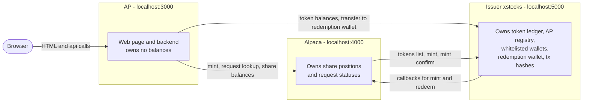
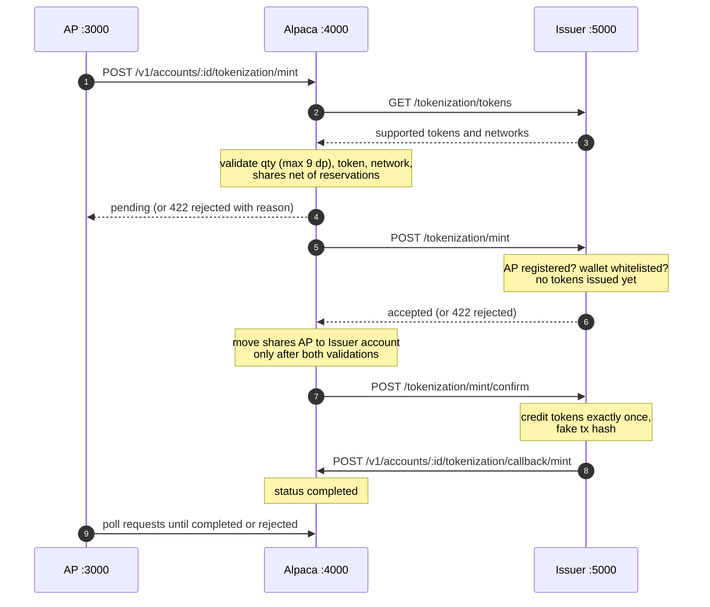
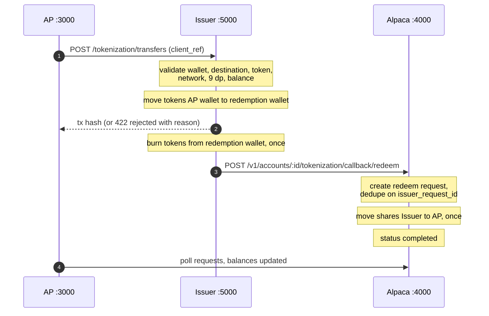
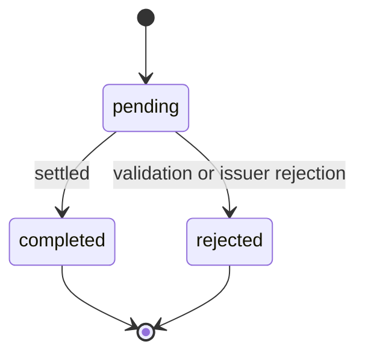
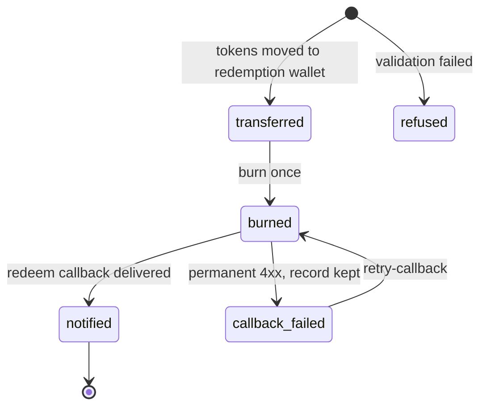

# Tokenized Stock Mint & Redeem (Tokka Labs assignment)

Simulation of Alpaca's Instant Tokenization Network as three independent
Node.js + Express services using real HTTP calls and in-memory state.

> **Status: Phases 1-3 done (mint + redeem).** Both flows work end to end with validation, rejections and failure recovery. Optional extras (X-API-KEY, Idempotency-Key, live log) are not built yet.

## Run
```bash
npm install
npm start      # AP http://localhost:3000, Alpaca :4000, Issuer :5000 (Ctrl+C stops)
npm test       # starts all services, runs 29 end-to-end checks, stops them
```
Requires Node 18+ (uses built-in `fetch`).

## Architecture


Three separate processes talking only over HTTP. Each service keeps its own in-memory data and never reads another's.
| Service | Port | Owns | Phase 1 endpoints |
|---|---|---|---|
| AP | 3000 | nothing (UI + client) | `GET /`, `/api/config`, `/api/balances`, `/api/requests`, `POST /api/mint`, `POST /api/redeem`, `GET /api/redemptions` |
| Alpaca | 4000 | share positions, request statuses | `GET /v1/accounts/:id`, `.../positions`, `POST .../tokenization/mint`, `GET .../tokenization/requests[/:rid]`, `POST .../tokenization/callback/mint`, `POST .../tokenization/callback/redeem`, test hook `POST /admin/faults` |
| Issuer | 5000 | token ledger, AP registry, redemption wallet, mint records | `GET /tokenization/tokens`, `POST /tokenization/mint`, `POST /tokenization/mint/confirm`, own-design `POST /tokenization/transfers`, `GET /tokenization/redemptions[/:id]`, `POST /tokenization/redemptions/:id/retry-callback`, plus reads `/tokenization/{issuer,aps/:id,wallets/:addr/balances,supply,mint/:id}` and test hook `POST /admin/faults` |

Every service also exposes `GET /health`.

## Mint flow

Statuses: `pending` -> `completed` | `rejected` (with a `reason`). Each request also carries a `step` and an `events` audit trail.

**Rejections** (visible in the AP page and in `GET .../tokenization/requests`): insufficient shares, unsupported token, unsupported network, invalid / more than 9 decimal places quantity (rejected synchronously with HTTP 422); unregistered / non-whitelisted wallet (rejected by the Issuer, so request goes `pending` -> `rejected`, no shares move).

**Safety properties**
- Shares are reserved when a request is accepted (concurrent mints cannot spend the same shares) and move only after the Issuer accepts.
- Tokens are credited exactly once per `tokenization_request_id`; repeated confirm/callback calls are no-ops.
- Partial failure: the request stays `pending` with its `step`, `attempts` and `last_error`; Alpaca's reconciler and the Issuer's callback retry resume it. A `rejected` callback after shares moved returns the shares to the AP.
- Quantities use BigInt fixed point (9 dp), never floats.

## Redeem flow

`POST /tokenization/transfers` body: `{from_wallet, to_wallet, token_symbol, qty, network, client_ref}` -> `{status, redemption_id, tx_hash}` (or 422 `{status:'rejected', reason}`).
Issuer redemption status: `transferred` -> `burned` -> `notified` (or `rejected`, or `callback_failed` after a permanent callback error). Alpaca request status: `pending` -> `completed`.

**Redeem rejections:** more tokens than the wallet holds, unsupported token/network, more than 9 decimals, wallet not a registered AP's, destination not the redemption wallet. All return 422 with a reason and appear in the AP page's "Redemptions at Issuer" table.

**Callback failure recovery (tested):** (a) Issuer drops the callback after burning: tokens stay burned once, shares wait, Issuer retries, shares returned once. (b) Alpaca fails before processing: Issuer retries. (c) Alpaca processes but the response is lost: the retry is deduped on `issuer_request_id`, so shares are returned once.

## Permanent redeem-callback failure: record preservation and recovery runbook
If Alpaca answers the Issuer's redeem callback with a 4xx (permanent: bad payload, unknown account, ...), the Issuer **stops retrying but keeps the redemption record** (tokens are already burned, the tx hash and payload are retained):
`status: "callback_failed"`, `needs_attention: true`, `callback_error: "alpaca returned 422: ..."`, `burned: true`. It shows in the AP page ("NEEDS ATTENTION") and in `GET /tokenization/redemptions?wallet=...`. Shares are not returned yet, and nothing is lost.

Recovery (after fixing the cause):
```bash
# 1. find stuck redemptions
curl -s localhost:5000/tokenization/redemptions | node -e "let s='';process.stdin.on('data',d=>s+=d).on('end',()=>console.log(JSON.parse(s).filter(r=>r.needs_attention)))"
# 2. re-send the callback (idempotent; Alpaca dedupes on issuer_request_id, burn is never repeated)
curl -s -X POST localhost:5000/tokenization/redemptions/<id>/retry-callback
```
-> `202`, Issuer record becomes `notified`, Alpaca creates the redeem request and returns the shares exactly once. Repeating the retry returns `200 {idempotent:true}`. Transient failures (network errors, 5xx) retry automatically and need no manual step.

**Duplicate transfer prevention:** `POST /tokenization/transfers` requires `client_ref` (idempotency key; 400 if missing). The same key returns the original result and tx hash without moving tokens again, including concurrent duplicates; the same key with different parameters returns 409. The AP page sends a fresh key per click and disables the button while a request is in flight. Note a replayed *rejected* transfer returns the same rejection for that key.

### Status lifecycles
Alpaca request (what the AP polls):

Issuer redemption record:


## Seed data
- Alpaca: AP account `ap-account-001` = 10 AAPL, 5 TSLA; Issuer custody `xstocks-custody-001` = 0 AAPL, 0 TSLA
- Issuer `xstocks`: tokens AAPLx, TSLAx on `solana`; AP `ap-001` registered with one whitelisted wallet; redemption wallet exists
- AP token balances start at 0 (tokens only exist after a mint). Account linking is treated as already done.

## Assumptions / deviations so far
- Issuer read endpoints, `/tokenization/supply`, and `/admin/faults` are my own design (not in Alpaca docs).
- Mint request/payload field names (`underlying_symbol`, `token_symbol`, `qty`, `network`, `wallet_address`, `issuer_id`, `account_id`) are from memory of the guides, NOT yet verified against them.
- Redeem: Alpaca creates the redeem request when the Issuer's callback arrives (so it is not visible at Alpaca before the burn); Alpaca generates its own `tokenization_request_id` and dedupes on the Issuer's `issuer_request_id`. This and the callback payload are my design, unverified against the guides.
- Validation rejections return HTTP 422 with the stored request (status `rejected`) instead of a bare error, so the AP history shows them.
- Env `STEP_DELAY_MS` (300) / `RETRY_MS` (1000) control visible transitions and retry cadence.
- Alpaca response shapes for accounts/positions are simplified from the real Trading API.
- Details: `notes/decisions.md`. Plan: `notes/plan.md`. Log: `notes/progress.md`.

## One-command demo (no extra terminals)
```bash
npm run demo   # starts the stack, runs mint, redeem, rejections and a callback failure, prints each step, stops
```
